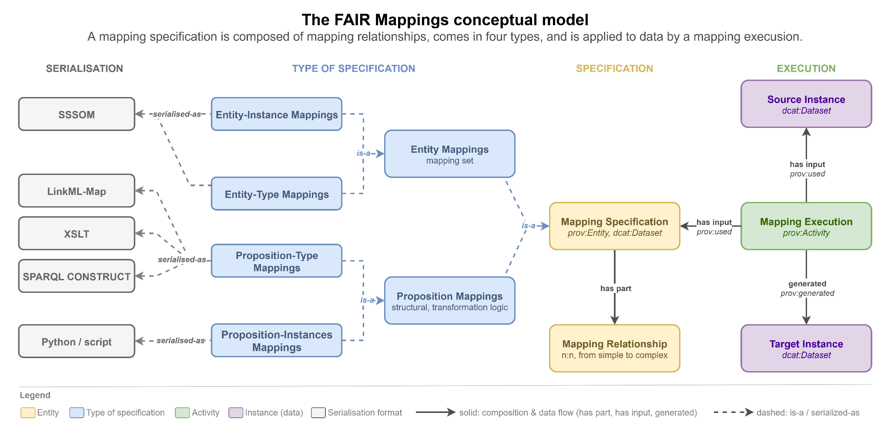
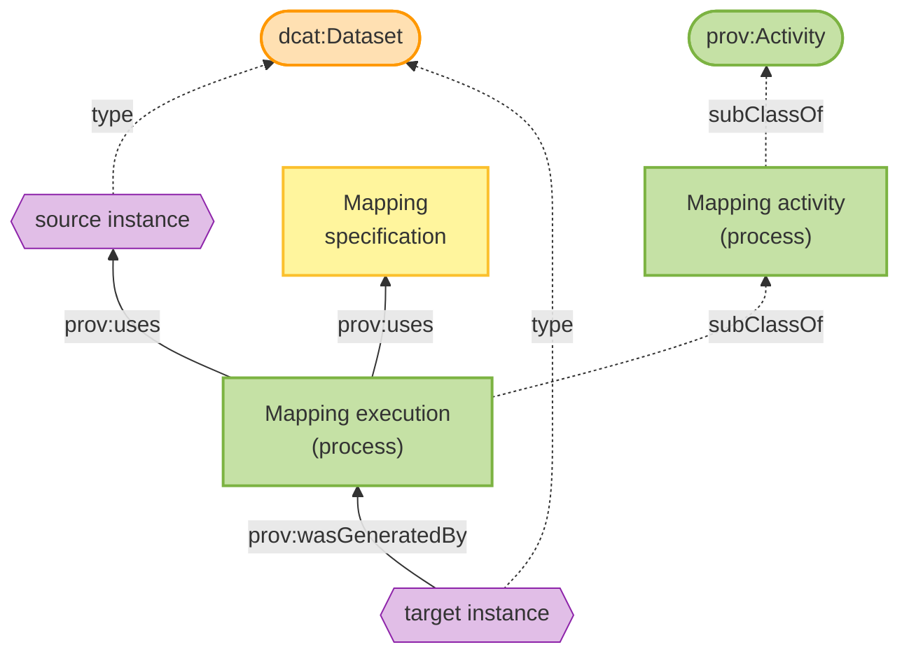
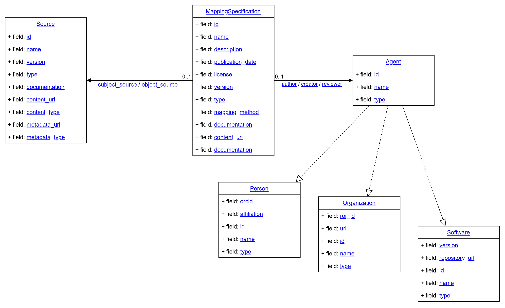

# Conceptual Model

This page describes the high-level conceptual model used by the FAIR Mappings Working Group to classify and describe different types of mappings and mapping-related activities.

!!! warning

    The terminology and definitions on this page are preliminary and subject to change based on community feedback.

## Overview

The conceptual model provides a common vocabulary for discussing mappings across different domains and use cases. It separates three things that are all commonly called "mapping": the *mapping specification* (the artefact that states what corresponds to what, and how), the *mapping activity* (creating, documenting and maintaining specifications), and the *mapping execution* (applying a specification to transform data).

The model is built around the idea of a **semantic model**: a semantic artefact, such as a vocabulary, ontology, database or schema, that represents a referent system for a purpose. Two kinds of semantic models are distinguished:

- A **semantic entity model** defines entities that each carry meaning on their own, like the terms of a dictionary (e.g. the Uberon term `UBERON:0000955` "brain").
- A **semantic proposition model**, comparable to a sentence, represents compositions of entities and the relationships between them, where each entity occupies a slot with a particular role (e.g. the fields of a metadata record).

Mappings between entity models support *terminological* interoperability; mappings between proposition models support *propositional* interoperability.

### Mapping Specification

*Figure 1: The FAIR Mappings conceptual model.*

A mapping specification is composed of mapping relationships and comes in four types: entity-type, entity-instance, proposition-type and proposition-instance mappings. See [Mapping Specification](#mapping-specification_1) for details.

### Mapping Execution

A mapping execution uses a mapping specification and a source instance as inputs, and generates a target instance as output. See [Mapping Execution](#mapping-execution_1) for details.

## Core Concepts

### Mapping Specification

A **mapping specification** is a semantic artefact that explicitly specifies one or more mapping relationships between the entities of a source semantic model and a target semantic model. It serves as the central concept in our model. A specification with no declared source or target model, or with no mapping relationship, is not well-formed.

A mapping specification:

- Is both a **dataset** (`dcat:Dataset`: can be published, versioned, and cited) and an **entity** (`prov:Entity`: can be tracked through provenance)
- Connects a single **source model** to a **target model**
- Contains one or more **mapping relationships** as its parts
- Can be serialized in various formats (e.g., SSSOM, LinkML-Map, XSLT, SPARQL CONSTRUCT, Python scripts)
- Should include metadata for findability and reusability (see [Recommendations](recommendation.md) and the [FAIR Mappings Schema](#metadata-the-fair-mappings-schema))

### Mapping Relationship

A **mapping relationship** is the structurally atomic unit of a mapping specification: a correspondence asserting that elements of one semantic model correspond to elements of another, under a defined mapping predicate or transformation rule. Mapping relationships can range from simple equivalence assertions to transformation rules.

There are two basic kinds:

- An **entity relationship** maps an entity of one semantic entity model to an entity of another (e.g. `skos:exactMatch` between two ontology terms, or `owl:sameAs` between two identifiers for the same individual). Entity relationships are independent of each other, which is why they serialise well as flat, order-independent rows, as in SSSOM.
- A **position relationship** maps a slot of a source proposition model to the corresponding slot of the target model (e.g. a column across two tables, or a field across two records). Position relationships within a specification are mutually constrained, so they need structure-aware serialisations rather than flat tables.

A mapping relationship may specify:

- One or more **source elements**
- One or more **objects** (target elements being mapped to)
- A **predicate** or **relation** describing how subjects and objects correspond (e.g., `skos:exactMatch`, `skos:broadMatch`, `owl:equivalentClass`)
- **Transformation rules** defining how source values are converted to target values (e.g., concatenation, splitting, unit conversion, conditional logic)
- **Constraints** that must be satisfied for the mapping to apply (e.g., value ranges, cardinality restrictions, conditional applicability)
- Optional **metadata** such as confidence scores, justifications, or provenance

More complex correspondences, such as merging, splitting, or restructuring fields, are not larger relationships but compositions of several mapping relationships. The complexity of a mapping specification is a matter of how its relationships are composed, not of the arity of any single one.

### Types of Mapping Specifications

The model distinguishes two categories of mapping specifications, **entity mappings** and **proposition mappings**, each with a type-level and an instance-level subtype.

#### Entity Mapping

An **entity mapping** specification relates identified entities across two semantic entity models, and is composed of entity relationships.

- **Entity-type mappings** relate classes or general terms, one concept in a source vocabulary to a concept in a target vocabulary (e.g. Mondo's mappings to OMIM, Orphanet and ICD-10). They account for the majority of published mappings today. An entity-type mapping specification serialised in SSSOM is called a **mapping set**.
- **Entity-instance mappings** relate individuals rather than classes: two identifiers that denote the same particular thing, typically with `owl:sameAs` (e.g. the WOD–NVS case study, which links specific ship names to ICES platform codes).

#### Proposition Mapping

A **proposition mapping** specification relates propositional structures (semantic proposition models) rather than isolated entities. It is composed of position relationships, complemented by the entity relationships that its slot constraints require.

- **Proposition-type mappings** relate types of proposition models, i.e. schemas, data models, or metadata standards, at the level of classes, properties and fields (e.g. DCAT-AP to Schema.org). They frequently require transformation logic beyond simple equivalence, such as combining or splitting fields, applying functions or lookups, or unit conversions, and are usually serialised as XSLT, SPARQL CONSTRUCT, LinkML-Map or executable scripts.
- **Proposition-instance mappings** relate two particular datasets rather than two schemas, asserting how the records of one correspond to the records of another (e.g. linking a record in one database to the record of the same observation event in another).

Instance-level mapping specifications of either category can be authored directly (typically citing the corresponding type-level mapping as justification), or obtained by applying a type-level mapping specification to source data, in which case they are a product of a [mapping execution](#mapping-execution_1).

### Mapping Activity

A **mapping activity** is a type of provenance activity (`prov:Activity`) representing the broader process of creating, maintaining, or applying mappings. This includes activities such as:

- Authoring new mapping specifications
- Reviewing and validating existing mappings
- Executing mappings to transform data
- Updating mappings when source or target systems change

### Mapping Execution

**Mapping execution** is a specific type of mapping activity focused on applying a mapping specification to transform actual data.

Key aspects of mapping execution:

- It is a **subtype of mapping activity**
- It takes a **mapping specification** as input
- It takes a **source instance** (the data to be transformed) as input
- It produces a **target instance** (the transformed data) as output
- Different mapping specifications may require different execution environments or tools

Both **source instance** and **target instance** are datasets that can be cataloged, versioned, and discovered through standard data catalog infrastructure.

## Serialization Formats

Mapping specifications can be serialized in various formats depending on the type of mapping and intended use:

| Format | Typical Use Case |
|--------|------------------|
| **SSSOM document** | Entity mappings (mapping sets), particularly for ontology terms or identifiers |
| **LinkML-Map specification** | Proposition-type mappings with transformation logic |
| **XSLT script** | XML-based proposition-type transformations |
| **SPARQL CONSTRUCT** | RDF-based proposition-type transformations |
| **Python script** | Complex programmatic transformations |

The choice of serialization format depends on factors such as:

- The complexity of the mapping logic required
- The source and target data formats
- Tooling availability and community adoption
- Requirements for human readability vs. machine executability
- Requirements for reusability / composability.
- Does the format support easy mix-and-match type of mapping specification creation?

## Relationship to Standards

The conceptual model aligns with established standards:

- **DCAT** (Data Catalog Vocabulary): Mapping specifications are treated as datasets that can be cataloged and discovered
- **PROV** (Provenance Ontology): Mapping activities and executions are tracked as provenance activities, with clear inputs and outputs
- **SSSOM**: The recommended format for representing mapping sets
- **LinkML-Map**: A framework for proposition mappings with executable transformation logic

## Metadata: the FAIR Mappings Schema

The conceptual model defines what a mapping is; the [FAIR Mappings Schema](https://mapping-commons.github.io/fair-mappings-schema/) makes a mapping specification findable, citable and reusable. It is a deliberately minimal LinkML model that describes the specification from the outside, and does not model the individual mapping relationships, which stay in the native formalism the authors chose (reached via `content_url`).

*Figure 2: Class diagram of the FAIR Mappings Schema.*

The schema has three main classes:

- **MappingSpecification**: the root class, with identifier, name, description, publication date, license, version, content URL, and a type drawn from an enumeration of mapping formalisms (e.g. SSSOM, R2RML, RML, XSLT, LinkML-Map).
- **Agent**: an abstract class specialised into Person, Organization, and Software, attached through distinct `author`, `creator`, and `reviewer` roles.
- **Source**: each of the two systems a specification relates (`subject_source` and `object_source`), with id, version, type, and pointers to its content and metadata.

## See Also

- [FAIR Mapping Recommendations](recommendation.md) - Technical recommendations for making mappings FAIR
- [Case Studies](use-cases.md) - Real-world examples of different mapping types
- [Resources](resources.md) - Tools and standards for working with mappings
- [The Semantic Mapping Vocabulary](https://mapping-commons.github.io/semantic-mapping-vocabulary/) - specifying some of the concepts from this code model (and more) as a formal RDF Vocabulary ([Browse on OLS](https://www.ebi.ac.uk/ols4/ontologies/semapv))
